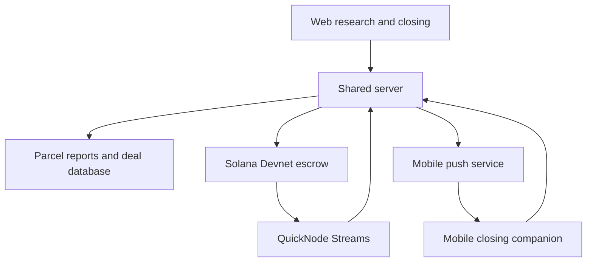
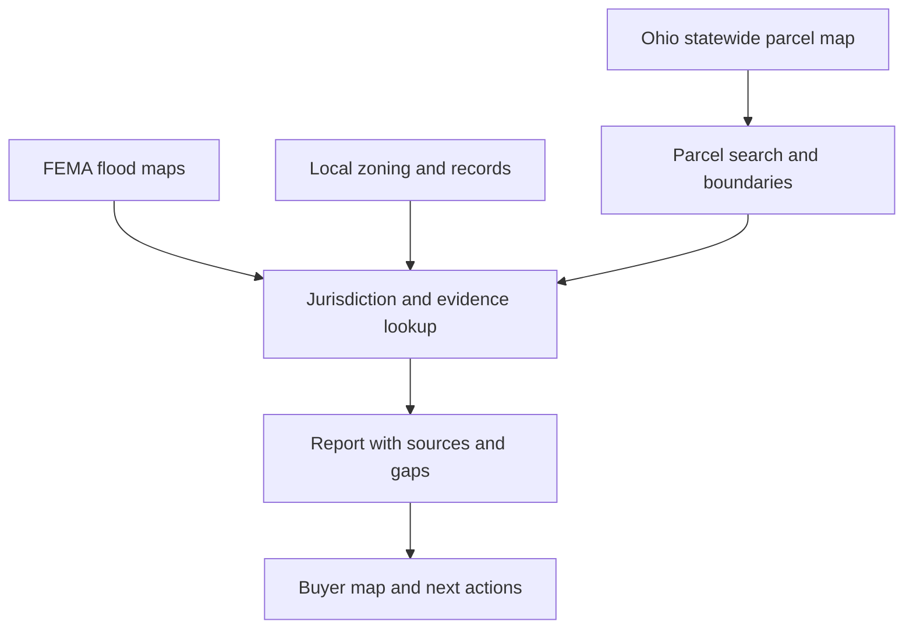
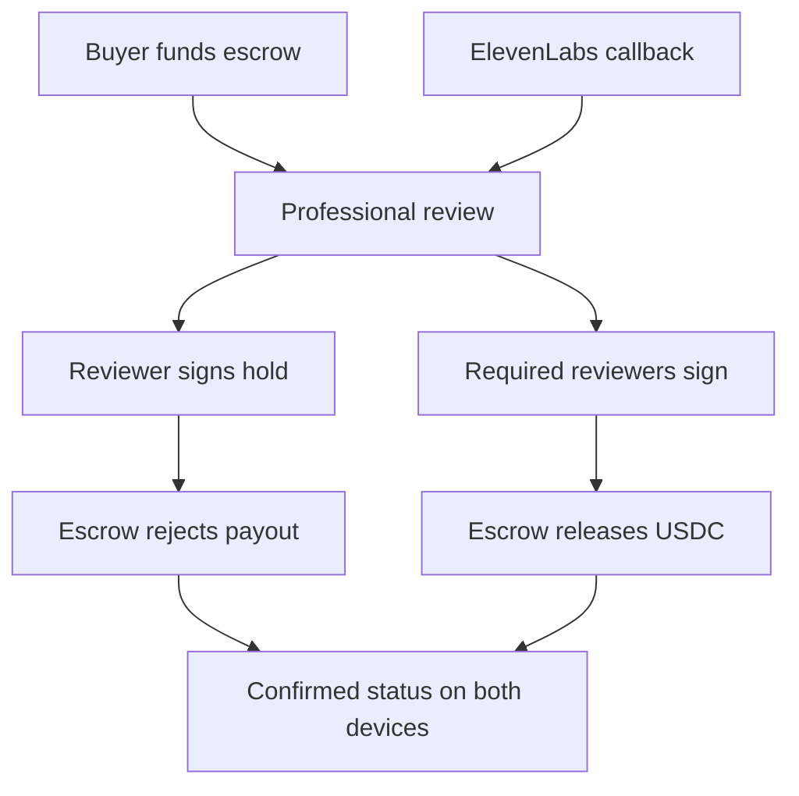

# GroundTruth architecture

**Working draft for team discussion.** These diagrams describe the user journey and system boundaries. The team still needs to decide the frontend setup, backend services, data storage, and deployment. See the [problem brief](../context/Problem.md) for the buyer and evidence, and the [UBC brief](../ubc/UBC-Hackathon.md) for competition priorities.

## Website and phone

The **website** is the research desk. A buyer searches by parcel ID or address where supported, browses a larger map, compares parcels, and opens the underlying records. The **phone** is the closing companion. The buyer opens their deal, sees the balance and next action, and can receive an alert when an approval or hold lands. Both surfaces read the same deal. A buyer can also follow the closing from the website.

The server handles data retrieval, account access, report generation, private case notes, and updates for both clients. The database holds source metadata, reports, private review evidence, and a view of the closing timeline. Wallets sign actions that affect escrow. The chain is authoritative for holds, approvals, balances, and payout. The timeline reflects confirmed chain activity.

## Parcel discovery and report coverage

**Target Ohio-wide discovery.** Ohio's OGRIP parcel map standardizes county parcel and assessment data. Validate how the public dataset can be queried or ingested, what fields it exposes, and which counties are available. Search and map multiple counties early. Use one repeatable report pipeline with geographic layers such as FEMA flood maps and local lookups for zoning, access, utilities, easements, and site-specific questions. [Ohio Parcels][ohio] · [FEMA National Flood Hazard Layer][fema]

| What we can show | How to describe it |
| --- | --- |
| Searchable parcel with a mapped boundary | Show where the geometry came from and when it was checked. |
| A finding supported by a record | Show the authority, source, and date. AI can summarize the finding and suggest a next step. |
| Missing records, conflicting results, or fieldwork needed | Mark that check as unresolved and name the agency or professional who can address it. |
| Coverage outside Ohio | Add a second geography if its data can feed the same pipeline and the team can verify the resulting map and evidence. Report actual coverage by source. |

Parcel coverage and report depth are separate measures. Track which counties are searchable, which checks return usable evidence, and where data is missing. A well-understood parcel can anchor the stage demo while the product supports discovery across a much larger area.

## Closing and phone handoff

A callback adds evidence for the reviewer. The reviewer decides whether to sign a hold. The escrow checks required signers, the active hold, and the agreed payout destination. Use staged participants and Devnet funds. Explain the buyer's next step after a hold, including the applicable refund path. Deed transfer remains in the off-chain closing process.

The web closing screen can show a QR code for an HTTPS deal link. With the installed app and platform link configuration, the link can open the same deal on the phone. Provide a mobile-web route for judges without the app. Authenticate the buyer on the phone before displaying private information, and keep credentials and deal details out of the QR payload. After a confirmed hold or approval, the backend can send a push alert that opens the deal. [Expo linking][linking] · [Expo push setup][push]

## Frontend options to decide

| Option | When it makes sense |
| --- | --- |
| **React web + Expo React Native** | Good fit for a map-heavy browser workspace and a simpler native companion. Share report and deal models, API clients, and design tokens. Keep mapping, navigation, and wallet interactions platform-specific where needed. |
| **Expo across web, iOS, and Android** | Expo supports browser builds with React Native Web. Consider this if a quick test confirms the web map, wallet flow, and shared screens work well together. Platform-specific components are still possible. |
| **Responsive web first, native companion next** | Keeps research and closing available through a judge-friendly link. The same backend and deal URLs give a native companion a clear integration point when ready. |

**Suggested check before choosing:** Load an actual Ohio parcel on desktop, open its staged deal on a phone, and verify the chosen wallet and notification path on the target devices. A real native push demo needs an installed build, notification permissions, and platform credentials. Budget time for that setup if native push is part of the submission. [Expo web][web] · [Expo push setup][push]

[ohio]: https://ohioparcels-geohio.hub.arcgis.com/
[fema]: https://www.fema.gov/flood-maps/national-flood-hazard-layer
[web]: https://docs.expo.dev/workflow/web/
[linking]: https://docs.expo.dev/linking/overview/
[push]: https://docs.expo.dev/push-notifications/push-notifications-setup/
