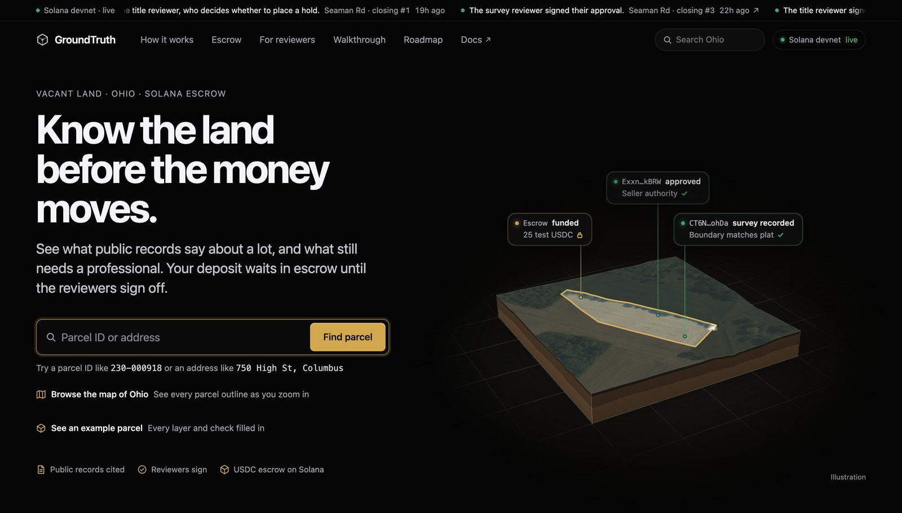
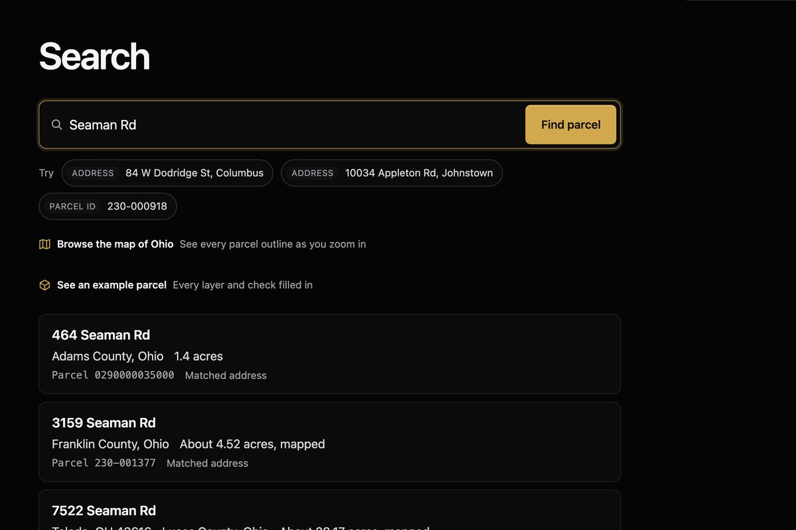
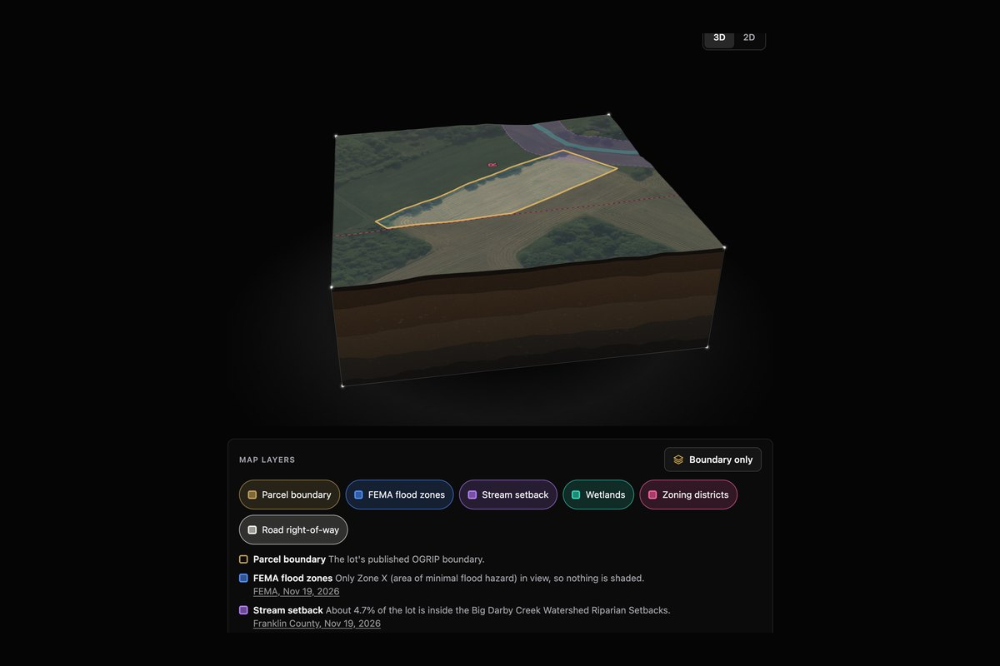
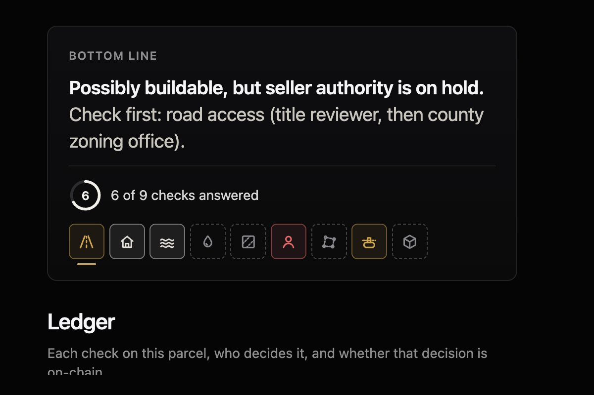
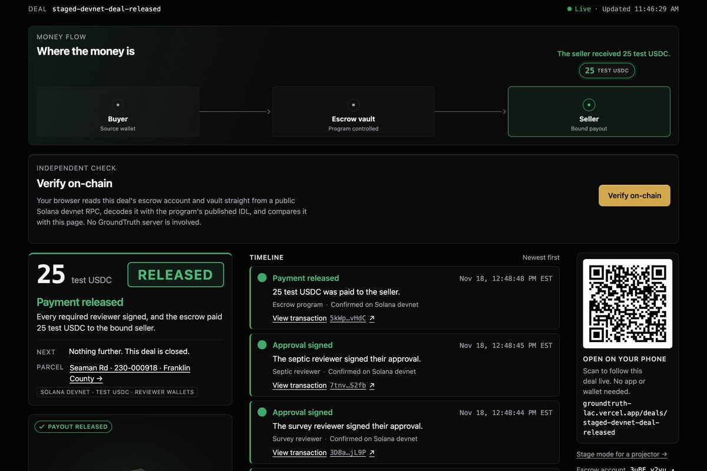
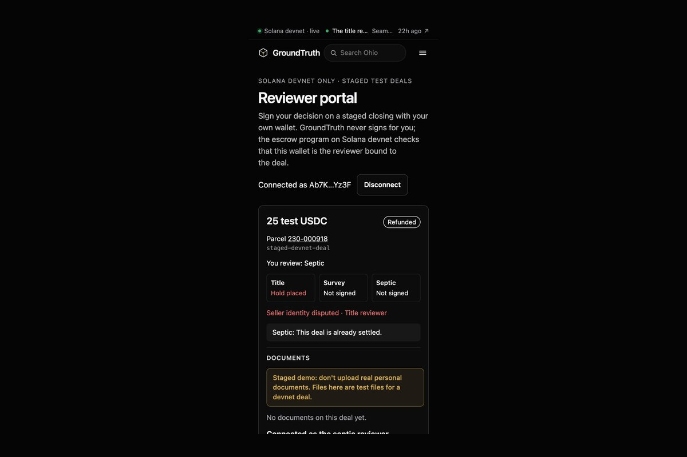
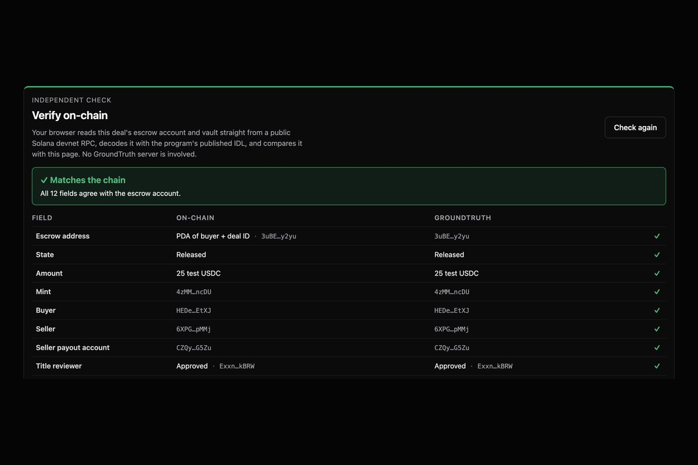
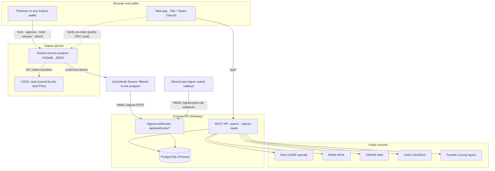

<p align="center">
  <a href="https://groundtruth-lac.vercel.app"></a>
</p>

<h1 align="center">GroundTruth</h1>

<p align="center"><strong>Know the land before the money moves.</strong></p>

<p align="center">
  <a href="https://github.com/hudakjoseph28/GroundTruth/actions/workflows/ci.yml"></a>
  <a href="https://explorer.solana.com/address/ASQoBtBsz1igQXsWzKZqFYqBGtBX4ErCJjNpuo8rEBZG?cluster=devnet"></a>
  <a href="LICENSE"></a>
</p>

<p align="center">
  <a href="https://groundtruth-lac.vercel.app"><b>Live app</b></a> ·
  <a href="VIDEO_LINK_HERE"><b>Demo video</b></a> ·
  <a href="https://groundtruth-lac.vercel.app/walkthrough"><b>Walkthrough</b></a> ·
  <a href="https://groundtruth-lac.vercel.app/proof"><b>Proof page</b></a> ·
  <a href="DEVPOST_LINK_HERE"><b>Devpost</b></a>
</p>

GroundTruth helps a first-time buyer of vacant land in Ohio find a parcel, read what public records actually say about it (and what they don't), and pay through a Solana escrow that only releases when the professionals sign off. Public records supply the evidence. Reviewers sign the decisions from their own wallets. The Anchor program decides whether money moves.

**Built for UBC 2026.** Track: TRACK_HERE · Chain award: Best Use of Solana · Bounties: QuickNode, ElevenLabs

## What it does

- **Find any Ohio parcel** by address, street, or parcel ID, using the state's published boundaries for all 88 counties.
- **See the land in 3D** on real aerial imagery and terrain, with toggleable FEMA flood, wetlands, stream-setback, zoning, and road layers.
- **Read the lot's elevation**: a height-colored layer with contour lines, steep-slope (over 15%) shading, the lowest and highest points, total rise, average and steepest slope, and a draggable elevation profile. It is map-derived USGS 3DEP elevation, labeled as not a survey.
- **Get a straight answer.** A "Bottom line" up top, then nine checks (flood, wetlands, septic soils, zoning, road access, and more), each with its source, its date, what it doesn't prove, and who can resolve it. Missing data says *No answer yet*. It never guesses.
- **Pay safely.** Test USDC sits in a Solana escrow. A title, survey, or septic reviewer's hold blocks the payout on-chain; once every required reviewer approves, the exact amount goes to the seller the deal was opened with.
- **Follow the deal from your phone**, with no app or wallet. The deal page updates from QuickNode Streams, links every step to Solana Explorer, and has a **Verify on-chain** button that checks the page against the chain from your own browser.

## Screenshots

All six are from the live site. The parcel and deals are real: a Franklin County lot and staged closings on Solana devnet with test USDC.

<table>
  <tr>
    <td width="33%"><br><sub><b>Search</b>: live OGRIP results across Ohio counties</sub></td>
    <td width="33%"><br><sub><b>3D land with layers</b>: parcel 230-000918, every layer on</sub></td>
    <td width="33%"><br><sub><b>Report</b>: the Bottom line and the closings on this parcel</sub></td>
  </tr>
  <tr>
    <td width="33%"><br><sub><b>Deal page</b>: money flow, timeline, phone QR</sub></td>
    <td width="33%"><br><sub><b>/review on a phone</b>: the reviewer's own wallet signs*</sub></td>
    <td width="33%"><br><sub><b>Verify on-chain</b>: 12 of 12 fields match devnet</sub></td>
  </tr>
</table>

<sub>* For this screenshot, the phone browser was given a read-only stand-in for Phantom that exposes the staged septic reviewer's public key and cannot sign. Pages built on made-up data, [`/parcels/sample`](https://groundtruth-lac.vercel.app/parcels/sample), [`/deals/sample`](https://groundtruth-lac.vercel.app/deals/sample), and [`/walkthrough`](https://groundtruth-lac.vercel.app/walkthrough), are tagged **Example · Illustrative data** on the site and are not shown above.</sub>

## How it works



The browser only ever calls the GroundTruth API and the user's wallet. Provider keys and webhook secrets live on Railway. The API builds unsigned transactions (Solana Pay, Blinks) but **never signs for a buyer, seller, or reviewer**.

**A deal, from search to payout**

1. **Search.** The buyer finds a lot. The API reads its OGRIP boundary and runs every check at once, each with its own timeout. A slow or failed source becomes `unknown`, never a yes or no.
2. **Open the escrow.** `initialize_deal` fixes the buyer, seller, seller payout account, reviewers, mint, and amount in a deal PDA.
3. **Fund.** The buyer signs `fund` (from the deal page, or by scanning a Solana Pay QR code), and the exact amount moves into the vault.
4. **Review.** Title, survey, and septic reviewers open `/review` and sign `sign_approval` or `place_hold` from their own wallet. An approval can carry a document's SHA-256 in a Memo.
5. **Watch.** QuickNode streams each confirmed program transaction to the API, and the deal page updates for anyone holding the link.
6. **Settle.** With every approval in and no hold, `release` pays the bound seller. With a hold, `release` fails with `DealHeld`, and only the buyer can `refund`.

## On-chain (Solana)

**Program:** [`ASQoBtBsz1igQXsWzKZqFYqBGtBX4ErCJjNpuo8rEBZG`](https://explorer.solana.com/address/ASQoBtBsz1igQXsWzKZqFYqBGtBX4ErCJjNpuo8rEBZG?cluster=devnet) on devnet. Rust + Anchor 1.2.2, [deploy transaction](https://explorer.solana.com/tx/4jSbDspA2EBfhghHxmiZJ5mkce4Ho4CZ34aqawPdMVJzDGjJxXdRfxjjMREgiKdnfpxeDXVgUqpECTwb8T39P8NU?cluster=devnet). Its published IDL ([`uQZLX7r…wZma`](https://explorer.solana.com/address/uQZLX7rQRUceEZdPYyxFtE8ei386h3XKatFkRJ3wZma?cluster=devnet)) is identical to the checked-in one, and a backend test checks that. Source: [`escrow/programs/groundtruth_escrow`](escrow/programs/groundtruth_escrow/src).

| Instruction | Signer | What the program enforces |
| --- | --- | --- |
| `initialize_deal` | buyer | Creates the deal PDA and vault. Amount > 0, mint must be Circle devnet USDC, seller ≠ buyer, payout account must be the seller's USDC ATA, 1–8 unique reviewers (none can be the buyer or seller), at least one required. |
| `fund` | buyer | Only from `Draft`. Moves exactly `amount` from the buyer's USDC account into the vault and checks the vault grew by exactly that. → `Funded` |
| `sign_approval` | assigned reviewer | Only while `Funded`. The wallet must be assigned to the deal with that role. One approval per reviewer. |
| `place_hold` | assigned reviewer | Only while `Funded`. Records the reviewer, role, reason code (e.g. `SellerIdentityDisputed`), and time. → `Held` |
| `release` | anyone (fee payer) | Fails with `DealHeld` (6019) if a hold exists. Needs `Funded` and every required approval. Sends exactly `amount` to the bound seller's account and closes the vault once it is empty. → `Released` |
| `refund` | bound buyer | Only while `Held`. Sends exactly `amount` back to the buyer's own USDC account and closes the vault once it is empty. → `Refunded` |

Each instruction emits an Anchor event (`DealInitialized`, `DealFunded`, `ApprovalSigned`, `HoldPlaced`, `DealReleased`, `DealRefunded`). The backend decodes these with the IDL's Borsh coder.

**Accounts.** The deal is a PDA at seeds `["deal", buyer, deal_id]`, where `deal_id` is 32 bytes (for the demo deals, `sha256` of a fixed label, so every address is known in advance). It stores the parties, the seller payout account, the mint, the vault, the amount, the state, up to 8 reviewer assignments, and any hold. The **vault** is the deal PDA's associated USDC token account, so only the program can move funds out of it, signing with the PDA's seeds.

**Guarantees**

- **Terms are locked before funding.** Buyer, seller, payout account, reviewers, mint, and amount are set in `initialize_deal`. No instruction changes them later.
- **Exact payout to the bound seller.** `release` transfers `deal.amount`, no more and no less, to the payout account stored at setup. A different destination is rejected.
- **A hold blocks release.** `release` checks for a hold first and fails with `DealHeld`. The vault and seller balances don't move.
- **Only the buyer can refund**, and only after a reviewer's hold. Funds can only go back to the buyer's own USDC account.
- **No double settlement.** `Released` and `Refunded` are terminal, so a second `release` or `refund` fails the state check.

These rules are covered by 78 Anchor integration tests in [`escrow/tests`](escrow/tests/groundtruth_escrow.ts): wrong mint, wrong destination, unassigned signer, duplicate approval, missing approval, approval after hold, and repeated settlement.

**Document hashes via Memo.** In `/review`, a reviewer can attach a document to their approval. The transaction carries a Memo v1 instruction `groundtruth:doc:<sha256>` next to `sign_approval`. The Stream passes the memo through, and the deal timeline shows which file the reviewer relied on, so anyone with the file can re-hash it and compare. Example: the septic approval [`3WEAsdUE…9Q9w`](https://explorer.solana.com/tx/3WEAsdUEaYQsBiB4eY39mDJ2kSS82fpB8tnTwS5tGV7yo1CkjrNAx1rBsmma45BUr6gF2Zv7PdQFSEz5D5cj9Q9w?cluster=devnet) on a rehearsal deal. Separately, the parcel page can save a report's SHA-256 fingerprint as a Memo from the visitor's own wallet.

**Devnet receipts (Nov 18, 2026, 25 test USDC each)**

| Outcome | Transaction | Balances (buyer / vault / seller) |
| --- | --- | --- |
| **Hold blocks payout.** Release rejected with `DealHeld` (6019) | [`Rro8WA…vwGz`](https://explorer.solana.com/tx/Rro8WAjpc8w7s2taWhSeZaCUnxkLjN3Vx3iJCJdDboGTUVem8ZaX63FFvJhWaHFMHVLJ6EQwc4qG7H8r4MnvwGz?cluster=devnet) | 15 / 25 / 0 → **unchanged** |
| **Refund** to the buyer after the hold | [`SgPJ9j…yaSo`](https://explorer.solana.com/tx/SgPJ9jQCNZfHrp1ipKK3tQ6LYwSaGS9qdhpkshUt8zNJW9JJ2s5V8B9WYuzq5nxLy3sWGvT94ZduEvSDgMzyaSo?cluster=devnet) | 40 / closed / 0 |
| **Release** after three approvals | [`5kWpcH…vHdC`](https://explorer.solana.com/tx/5kWpcHzaj1gic1gAehkJcQztexDn2jL2Y765WSXjEvRiFrDmDkYiy5EwY4gYSeeJHo9C6DGnAXrQ9EWDPZhvvHdC?cluster=devnet) | 15 / closed / **25** |

Held deal [`54Va6q…E4tW`](https://explorer.solana.com/address/54Va6qKNQTsbuXTqi4tXaPVgdkQh4S7McsCKsjKPE4tW?cluster=devnet) · released deal [`3uBECm…y2yu`](https://explorer.solana.com/address/3uBECmkG9XKbJbGisPjqWNxy6Sb3knVZ2cnwF7jby2yu?cluster=devnet). The full step-by-step tables are in [`escrow/demo-results/`](escrow/demo-results/README.md) and on the [proof page](https://groundtruth-lac.vercel.app/proof).

## Sponsor integrations

### QuickNode Streams: confirmed chain state drives the timeline

- **Stream:** Solana Devnet, **Block** dataset, destination **Webhook** → `POST /api/webhooks/quicknode`.
- **Filter** ([`groundtruth-filter.js`](backend/quicknode/groundtruth-filter.js)): keeps every successful transaction that touched the escrow program (directly or by CPI), plus failed `release` attempts, so a `DealHeld` rejection appears on the timeline too. It also passes the text of any Memo instructions, which carry document hashes.
- **Webhook:** checks QuickNode's HMAC-SHA256 signature (`X-QN-Signature`) against the raw body and decodes events with the program's IDL. Only logs written while our program is executing count. Rows are deduplicated by signature and event index, so retries and replays do nothing. An event the stored deal can't accept (an approval after a hold, a payout to someone else) is refused, not applied. Unsigned requests get `401`.
- **Measured:** on Nov 18, the live stage deal's four transactions (initialize, fund, and the title and survey approvals) were applied straight from the Stream. Railway's HTTP log shows each webhook arriving **1–2 s after its block**. → [Proof](https://groundtruth-lac.vercel.app/proof#quicknode) · [log screenshot](docs/proof/quicknode-stage-prep.png)
- Details: [backend/README.md § QuickNode Stream webhook](backend/README.md#quicknode-stream-webhook).

### ElevenLabs: an owner callback, as evidence only

- **What:** an **ElevenLabs Agents** outbound call (through a Twilio number) phones the owner on record and asks whether they are selling. This targets seller-impersonation fraud. In the demo, the "owner" is a consenting teammate. No real parcel owner is called.
- **How:** the agent's `sale_answer` data-collection field arrives through ElevenLabs' HMAC-signed post-call webhook (`POST /api/webhooks/elevenlabs`). It becomes an **Evidence received** row on the deal timeline for the title reviewer. Only the outcome and conversation ID are stored. No transcript, audio, or phone number is stored.
- **Never authorization.** The call cannot approve, hold, or release anything. Only a reviewer's signature does that.
- **Recorded:** conversation `conv_9801m7rbaxvye0yrq4jmyzfyq6xz` on Nov 18. The API logged `elevenlabs recorded ownerDeniesSale … deal=staged-devnet-deal` at 22:10:54 UTC. → [Proof](https://groundtruth-lac.vercel.app/proof#elevenlabs) · [log screenshot](docs/proof/elevenlabs-owner-callback.png) · [agent prompt](backend/elevenlabs/owner-callback-agent.md)

### Circle devnet USDC

Every deal is denominated in Circle's devnet test USDC, mint [`4zMMC9srt5Ri5X14GAgXhaHii3GnPAEERYPJgZJDncDU`](https://explorer.solana.com/address/4zMMC9srt5Ri5X14GAgXhaHii3GnPAEERYPJgZJDncDU?cluster=devnet). The program hard-codes it and rejects any other mint.

### Solana Pay and Blinks

- **Solana Pay:** while a deal is a draft, its page shows a QR code for the [transaction request](backend/README.md#solana-pay-funding-transaction-request) `/api/deals/:id/solana-pay/fund`. The wallet receives an unsigned `fund` that only the buyer can sign. Funded on devnet: [`2SdfcZ…TH3u`](https://explorer.solana.com/tx/2SdfcZHdc3sUdgjksEKLnMBvV3XkTRXf1ipVwU4esH13NRjEGQous3yNpeXBxwk2xWXtNh3Thck7xcG1EphWTH3u?cluster=devnet) ([record](escrow/demo-results/devnet-solana-pay-fund-v1.md)).
- **Blink:** a [Solana Action](backend/README.md#reviewer-approval-blink-solana-action) (spec 2.4) lets an assigned reviewer sign their approval from any Blink client. `/actions.json` is live. It covers the rehearsal deal only, and it now shows as disabled because every reviewer on that deal has signed.

## Data sources

| Source | Used for | Coverage |
| --- | --- | --- |
| [Ohio OGRIP statewide parcels](https://services2.arcgis.com/MlJ0G8iWUyC7jAmu/arcgis/rest/services/OhioStatewidePacels_full_view/FeatureServer/0) + LBRS address locator | Search by address, street, or parcel ID; published boundaries; the `/explore` map | All 88 Ohio counties |
| [FEMA National Flood Hazard Layer](https://hazards.fema.gov/arcgis/rest/services/public/NFHL/MapServer) | Flood zone, Special Flood Hazard Area, floodway, FIRM panels | The 83 Ohio counties with an NFHL study. The other 5 return `unknown`. |
| [USFWS National Wetlands Inventory](https://fwspublicservices.wim.usgs.gov/wetlandsmapservice/rest/services/Wetlands/MapServer/0) | Wetland types and their share of the lot | Wherever NWI has mapped. Unmapped areas are `unknown`, never "none". |
| USDA NRCS SSURGO, through Soil Data Access (fallback: Esri Living Atlas [USA Soils Map Units](https://www.arcgis.com/home/item.html?id=d4c54647dd4c4405a9f4f0bc9fd351e9), USDA's gSSURGO) | Septic-tank absorption field rating per soil map unit | Every Ohio parcel. A screening, not a site evaluation. |
| Franklin County layers: FCEDP zoning districts, road right-of-way and road sections, stream buffers, Auditor | Zoning, road access, riparian stream setbacks, legal acreage | Franklin County only |
| USDA NAIP imagery (USGS National Map), AWS Terrain Tiles (USGS 3DEP in the US) | The 3D land view, elevation summary, contours, slope, and profile | Imagery and map elevation only, never a finding or a survey |

Every check stores its source URL and `retrievedAt`. How each one works and what was tested: [backend/README.md](backend/README.md#parcel-report-live-ogrip--fema--usda-ssurgo) · [Coverage](docs/phases/02-parcel-research/Coverage.md).

## Tech stack

| Layer | Tools |
| --- | --- |
| Web | React 19, Vite, TypeScript, Three.js, MapLibre GL, react-globe.gl, Solana wallet adapter (Phantom) |
| API | Node 26, Express 5, Zod, Prisma, PostgreSQL 16 |
| Chain | Rust, Anchor 1.2.2, SPL Token, SPL Memo, `@solana/web3.js`, Solana Pay transaction requests, Solana Actions (Blinks) |
| Integrations | QuickNode Streams, ElevenLabs Agents + Twilio, Circle devnet USDC |
| Shared | `@groundtruth/shared`: one TypeScript contract, the IDL, fixtures, and PDA helpers for web, API, and scripts |
| Tests and CI | Vitest, Supertest, Anchor/Mocha, LiteSVM, GitHub Actions |
| Hosting | Vercel (web), Railway (API + Postgres) |

## Run it locally

Requires **Node 26** (`.nvmrc`). pnpm does not need to be installed: the setup script runs the pinned `pnpm@12.18.0` through `npx`.

```bash
git clone https://github.com/hudakjoseph28/GroundTruth.git && cd GroundTruth
nvm install && nvm use          # Node 26
npm run setup                   # pnpm install --frozen-lockfile, then build every package
```

**Fastest: the web app against the deployed API** (no database, no keys):

```bash
GROUNDTRUTH_API=https://api-production-db8a8106.up.railway.app npx --yes pnpm@12.18.0 --filter @groundtruth/web dev
# open http://localhost:5173 and search 230-000918 or "84 W Dodridge St"
```

**Full stack: your own API and Postgres 16.** Webhook and voice secrets are optional. Without them, those routes answer `503`.

```bash
docker run --name groundtruth-postgres -e POSTGRES_USER=groundtruth -e POSTGRES_PASSWORD=groundtruth \
  -e POSTGRES_DB=groundtruth -p 5432:5432 -d postgres:16
cp backend/.env.example backend/.env           # DATABASE_URL already points at that container
npx --yes pnpm@12.18.0 --filter @groundtruth/backend db:migrate
npx --yes pnpm@12.18.0 --filter @groundtruth/backend db:seed
npx --yes pnpm@12.18.0 --filter @groundtruth/backend dev     # API on :3001
npx --yes pnpm@12.18.0 --filter @groundtruth/web dev         # web on :5173, proxies /api to :3001
```

## Testing

| Suite | Command | Tests | In CI |
| --- | --- | --- | --- |
| Backend unit + route (recorded provider responses, no network) | `pnpm --filter @groundtruth/backend test` | 774 | ✅ |
| Web | `pnpm --filter @groundtruth/web test` | 190 | ✅ |
| Backend against Postgres 16 | `pnpm --filter @groundtruth/backend test:db` | 49 | ✅ |
| Anchor escrow (local validator) | `pnpm escrow:test` | 78 | needs the Solana, Anchor, and Rust toolchains, so it runs locally |

Counts are from `main` on Nov 19, 2026. [CI](.github/workflows/ci.yml) runs on every PR and every push to `main`: typecheck, lint, the backend and web tests, the web build, and `db:migrate` → `db:seed` → `test:db` against a Postgres 16 service. It uses no secrets. The backend also replays the **real recorded devnet transactions** of both closings through the same filter, webhook, and decoder that live deliveries use.

## Repo map

```text
frontend/web/        Vite + React app: home, search, /explore, parcel report + 3D land, deal page, /review, /proof, /roadmap, /walkthrough
backend/             Express API: OGRIP search, report pipeline, deals, Solana Pay + Actions, QuickNode and ElevenLabs webhooks
  quicknode/         Stream filters pasted into QuickNode
  elevenlabs/        the owner-callback agent's prompt and data-collection spec
  prisma/            schema and migrations
escrow/              Anchor program (programs/), 78 integration tests (tests/), devnet demo scripts and receipts (scripts/, demo-results/)
packages/shared/     @groundtruth/shared: API contract types, escrow IDL, PDA helpers, fixtures
docs/                problem, architecture, data contract, decisions, phases, pitch, proof screenshots, README images
```

Start with [Architecture](docs/architecture/Architecture.md), the [data contract](docs/architecture/DataContract.md), and the [decision log](docs/architecture/Decisions.md). Contributors and AI agents should read [AGENTS.md](AGENTS.md).

## Team

| | Role |
| --- | --- |
| **Joey Hudak** | Frontend: the buyer web app |
| **Gagan Karnati** | Parcel data and integrations; originated the idea |
| **Kadhir** | Solana escrow: Anchor program, USDC vault, hold, release, refund |
| **Satya** | Backend, QuickNode Streams, ElevenLabs, deployment |

## Roadmap

Live today: the "Now" column. Next: a pilot with an Ohio title or closing company, mainnet USDC with sponsored fees, verified reviewer credentials, and more local checks. Later: nationwide parcels, deed e-recording handoff, and seller identity verification. Everything past "Now" is a plan, not a feature. → [groundtruth-lac.vercel.app/roadmap](https://groundtruth-lac.vercel.app/roadmap)

## Honest limits

- **Devnet and test USDC only.** No real money moves, and the program is not audited.
- **Staged wallets.** The buyer, seller, and title, survey, and septic reviewers are staged devnet keys controlled by the team, not licensed professionals.
- **Example pages are labeled.** `/parcels/sample`, `/deals/sample`, and `/walkthrough` use a made-up lot and deal, each tagged *Example · Illustrative data*. They never fall back into real parcels or deals.
- **Ohio only.** Parcels come from Ohio's OGRIP layer. Deeper checks (zoning, road access, stream setbacks) exist in Franklin County so far. Everywhere else they say *No answer yet*.
- **Decision support, not a verdict.** A report is not a legal buildability opinion, title search, survey, or septic permit.
- **Sponsor proofs have edges.** The held and released closings were backfilled into the timeline with `replay:devnet`, not delivered by the Stream (QuickNode backfill needs a paid plan). The ElevenLabs call was recorded after that deal's hold and refund, so it shows as evidence on a deal that had already settled.

## License

[MIT](LICENSE) © 2026 the GroundTruth team.
