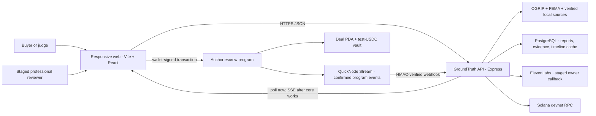
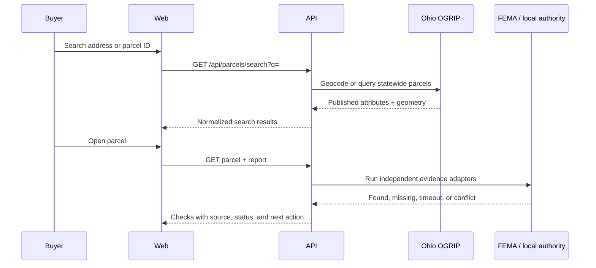
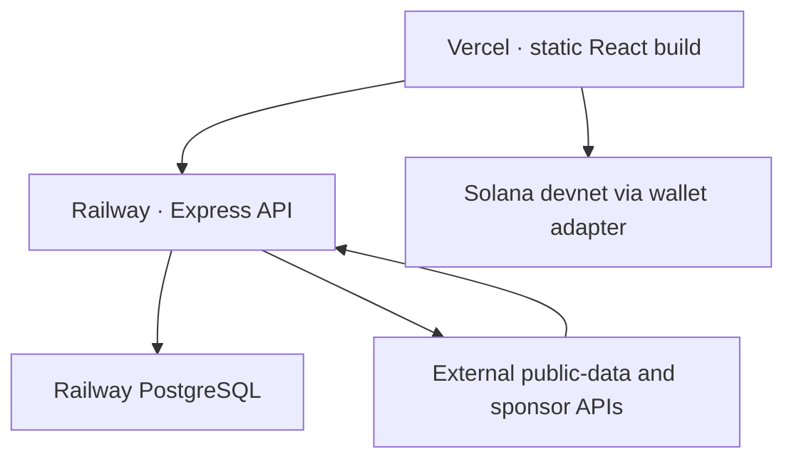

# GroundTruth · Architecture

**Status: accepted for the hackathon on Nov 12, 2026.** This file defines the system boundaries and source-of-truth rules. [Decisions.md](Decisions.md) names the chosen tools; [DataContract.md](DataContract.md) defines the interfaces. Change a boundary only when the current design prevents a phase acceptance check.

## The system in one sentence

A responsive React site calls one GroundTruth API; that API turns authoritative public records into explicit evidence states, stores private workflow data in PostgreSQL, and mirrors confirmed events from a deal-scoped Solana escrow into a buyer-readable timeline.

## Product boundary

GroundTruth does four things this week:

1. Searches real Ohio parcels by address or parcel ID and draws the published boundary.
2. Shows what an authoritative record supports, what is still unknown, who can resolve it, and the source date.
3. Holds test USDC in a Solana devnet program whose bound reviewers can approve or hold a staged closing.
4. Shows a rejected payout and a successful payout with balances and Explorer receipts.

GroundTruth does **not** issue a legal buildability opinion, replace a survey or title search, verify a real person's identity, transfer a deed, custody production funds, or promise deep record coverage for all 88 Ohio counties. Those claims would be dishonest and would expand the build past the demo.

## System map



The browser owns presentation and user signatures. The API owns provider adapters, normalization, access checks, and private evidence. The Anchor program alone authorizes movement from the vault. QuickNode reports confirmed on-chain events; it never creates them. ElevenLabs reports call evidence; it never approves or holds a deal.

**Verify on-chain (deal page).** A visitor can check the API's projection without trusting it: the browser reads the deal PDA and its vault from the public devnet RPC (`api.devnet.solana.com`, no key), decodes the `DealAccount` with the checked-in IDL (`packages/shared/src/idl`), re-derives the PDA from the account's own buyer and deal ID, and compares state, amount, mint, buyer, seller, payout account, each reviewer's `approved` flag, the hold, and the vault balance with the page. The API is not called for the check. Code: `frontend/web/src/verify`.

## Source of truth

| Question | Authority | Cached copy | Rule |
| --- | --- | --- | --- |
| Where is the parcel boundary? | OGRIP feature geometry | API response cache | Show source URL and retrieval time; never redraw a guessed polygon. |
| What does a record establish? | Named public authority or signed reviewer | Normalized `Check` in PostgreSQL | No source means `unknown`, not a model-generated answer. |
| Who may approve or hold? | Reviewer wallets bound when the deal is initialized | Deal row for display | The program rejects any unbound signer. |
| Is the deal funded, held, released, or refunded? | Confirmed Solana account and transaction state | Timeline projection in PostgreSQL | Chain state wins after disagreement or restart. |
| What happened in the owner call? | Verified ElevenLabs post-call webhook | Private evidence row | Store the minimum needed for the demo; a human reviewer decides the effect. |

## Parcel path



The first implementation queries Ohio's published statewide parcel FeatureServer through the API, never directly from the browser. The official endpoint is `https://services2.arcgis.com/MlJ0G8iWUyC7jAmu/arcgis/rest/services/OhioStatewidePacels_full_view/FeatureServer`. Direct parcel-ID search uses an allowlisted equality query. Address search calls the LBRS locator, takes the best Ohio match above the configured score threshold, then asks the parcel service for the polygon containing that point. Provider-specific field names stop at the adapter; the UI sees only the v1 contract.

Each evidence adapter has its own timeout and result. The report renders when some adapters fail. Coverage is reported in two numbers: counties returning searchable boundaries, and checks returning usable evidence. The stage demo uses one verified Franklin County golden parcel and at least one second-county boundary; the exact parcel ID enters the fixture only after a teammate checks the source manually.

## Closing path

```mermaid
sequenceDiagram
    participant B as Buyer
    participant R as Reviewer
    participant W as Web wallet
    participant P as Escrow program
    participant Q as QuickNode Stream
    participant A as API

    B->>W: Fund staged deal with test USDC
    W->>P: initialize_deal + fund
    R->>P: sign_approval or place_hold
    P-->>Q: Emit confirmed program event
    Q->>A: Signed webhook payload
    A->>A: Verify, deduplicate, project timeline
    W->>A: Poll deal timeline
    A-->>W: Confirmed state + transaction link
    B->>P: Trigger settlement
    alt active hold
        P-->>B: Reject; vault and balances unchanged
    else every required approval
        P-->>B: Pay bound seller once
    end
```

Every deal binds buyer, seller token account, mint, amount, and reviewer wallets before funding. Any fee payer may trigger `release`; the program controls the outcome and can send funds only to the bound seller token account once all required reviewers approve and no holds exist. An assigned reviewer may place a terminal hold. The buyer may call `refund` only while that hold is active. Both `release` and `refund` transfer the exact agreed escrow amount (`deal.amount`) and conditionally close the vault if zero surplus remains; unsolicited surplus tokens remain permanently locked in the vault PDA to ensure settlement cannot be blocked by griefing deposits. Both settlements are one-time terminal settlements. Any surplus token recovery requires a future contract upgrade or migration. Staged closings are associated with the golden parcel (`ohio:39049:230-000918`).

The demo uses two independent deals rather than mutating one deal between outcomes. This makes the story reproducible and keeps the held receipt available after the successful payout.

## Web and phone

There is one responsive web application. Desktop is the research desk; the same routes become the phone closing companion at narrow widths. The desktop closing screen displays a QR code for an HTTPS deal URL. For the staged demo, the URL opens public, non-sensitive fixture data in read-only mode; wallet actions still require the correct staged wallet. While a deal is a draft, the page also shows a Solana Pay transaction request (a `solana:` QR code and link). The wallet POSTs its account; the API answers only the bound buyer, with the `fund` transaction built from the IDL and left unsigned; the wallet signs and sends. No native Expo app, native push setup, or app-store build is part of the core scope.

## Deployment topology



- `frontend/web` deploys to Vercel with an SPA rewrite to `index.html`. It receives only public configuration such as the API base URL, cluster name, and program ID.
- `backend` and PostgreSQL deploy together on Railway. All provider credentials and webhook secrets stay there, and so does the optional devnet fee-payer key for reviewer fee sponsorship. That key signs only as fee payer, never as a deal party.
- `escrow` deploys to Solana devnet. The checked-in IDL and deployed program ID must match.
- Pull requests run lint, typecheck, unit tests, web build, API tests, and local Anchor tests. Devnet proof is a deliberate manual gate because faucets and RPCs are external.

## Trust, privacy, and failure rules

- Use a consenting teammate and staged phone number for the callback. Never call a real parcel owner during the demo.
- Do not put owner mailing addresses, identity documents, raw call audio, private phone numbers, secrets, or access tokens into parcel responses, model input, logs, Git, URLs, or QR codes.
- Verify QuickNode HMAC and ElevenLabs webhook signatures against the raw request body. Deduplicate Streams by transaction signature + event index and calls by conversation ID.
- Return webhook success only after the event is durably queued or written. Reprocessing the same delivery must be harmless.
- A provider timeout becomes `unknown` with a next action. A chain/RPC timeout becomes `pending confirmation`, never `released` or `held`.
- The model may rewrite supplied evidence into plain English. It may not browse independently, invent a source, assign a legal status, or authorize money movement.
- Test funds, staged roles, illustrative globe traffic, and incomplete coverage are labeled in the interface and video.

## Architecture exit check

The architecture is working when a fresh browser can search two counties, open the golden report with a source and a gap, fund or inspect the two staged deals, see a reviewer event arrive from the Stream, and verify both terminal outcomes without any browser-held secret or manual database edit. The phase files define the narrower proof required to get there.

[Ohio statewide parcel FeatureServer](https://services2.arcgis.com/MlJ0G8iWUyC7jAmu/arcgis/rest/services/OhioStatewidePacels_full_view/FeatureServer) · [Ohio parcels](https://ohioparcels-geohio.hub.arcgis.com/) · [Circle testnet USDC addresses](https://developers.circle.com/stablecoins/usdc-contract-addresses) · [QuickNode Streams webhook](https://www.quicknode.com/docs/streams/destinations/webhooks) · [ElevenLabs post-call webhooks](https://elevenlabs.io/docs/eleven-agents/workflows/post-call-webhooks)
