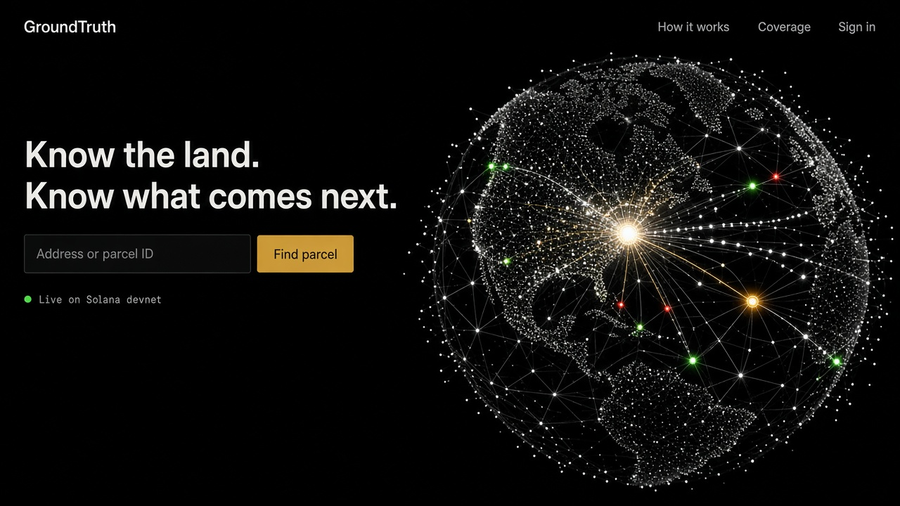

# GroundTruth · Vision

*Accepted visual and interaction spec · responsive web · Owner: Joey Hudak · Nov 12, 2026.*

## The feeling

I open GroundTruth and the first thing I feel is *whoa*. Off to the right is a globe that isn't made of land. It's made of thousands of points, all connected and all moving. Little pulses of light run between them nonstop, like a swarm of wallets talking to each other. A few points flash green. One goes red. One glows gold because someone, somewhere, is looking at a lot right now. Nobody has to tell me: land, people, and money are all running through one live network.

The second thing I feel is *calm*. The rest of the page is quiet. A name, a headline, and one search box sitting exactly where my eyes land. I know what to do immediately.

That contrast is the whole product. **The background is a network that never stops moving. The foreground is one clear next step.** The globe makes people stop and look. The usability makes them trust it.

When I leave a parcel page I should feel: **I understand this lot. I know what's still open. I know who's responsible for the next step, and I can verify it.**

## What ships first

The build has four routes and one shared visual system. Finish them in this order; do not add a fifth route before the four work together.

| Route | Job | Required first-pass state |
| --- | --- | --- |
| `/` | Explain GroundTruth and start search | Headline, search, sample link, lightweight globe |
| `/search?q=` | Choose the right Ohio parcel | Results with parcel ID, county, township, acreage when present |
| `/parcels/:parcelKey` | Understand the lot | Boundary, biggest open question, evidence cards, closing link when staged |
| `/deals/:dealId` | Understand the money | Amount, state, required reviewers, next action, timeline, Explorer links |

Desktop prioritizes research. At phone width, `/deals/:dealId` moves the amount, status, and next action above the map and evidence. This responsive route is the phone companion; there is no separate native experience in the core build.

## Design principles

1. **Usability beats spectacle.** If an effect ever competes with the search box, a status, or a next action, the effect loses. Everything sits where people expect it.
2. **Feel like macOS.** Precise type, generous spacing, flat surfaces, hairline borders, crisp focus states, no decoration that doesn't do a job. No glassmorphism or glow for its own sake. Transparency only where it helps layering, like a panel over a map.
3. **The globe is atmosphere you can play with, never a required control.** It delivers the *whoa*. You can grab it, spin it, and hover to see what's happening, but you never need it to search, select, or understand a parcel.
4. **Every color means something.** No legend. People learn the palette by repetition. Wherever someone has to act, the color comes with words. [W3C guidance on use of color](https://www.w3.org/WAI/WCAG22/Understanding/use-of-color.html)
5. **Crypto stays visible but quiet.** People should sense this runs on a live chain: wallet swarms, settlement pulses, a small "Live on Solana devnet" line. Nobody should need to understand crypto to buy land. Wallet connection appears only beside an action that needs a signature.
6. **Loading, empty, unknown, and error are designed states.** Skeletons preserve the map layout; empty search explains how to refine; missing evidence says `No answer yet`; chain latency says `Pending confirmation`. No blank cards or generic `Something went wrong` on the demo path.

## Palette

| Color | Meaning | Where it appears |
| --- | --- | --- |
| Near-black `#0A0A0A` | The surface | Every background |
| Off-white, gray | Type, boundaries, quiet network lines | Text, the globe's base nodes and edges |
| **Gold** | Attention: viewed, selected, or the primary action | The parcel being viewed on the globe, the **Find parcel** button, focus rings |
| **Green** | Completed or cleared | Settlement pulses on the globe; **Signed off** and **Released** labels |
| **Red** | Held or blocked | Blocked nodes on the globe; **Hold** and **Blocked** labels with the reason in words |

If a color isn't in this table, it isn't in the product. Gold is the smallest bright thing on the page, so the search button keeps the eye.

## The homepage

**Layout:** two columns on a black canvas. Left third: content. Right two-thirds: the globe. Nothing else competes above the fold.

- **Header:** **GroundTruth** wordmark left. Right: **How it works**, **Coverage**, **Sign in** in quiet gray.
- **Headline:** **Know the land. Know what comes next.**
- **Search:** one wide field for an address or parcel ID, gold **Find parcel** button, and a small **Explore a sample parcel** link below.
- **Live line:** small monospace text with a pulsing green dot: **Live on Solana devnet**. Later it can rotate through real counts (parcels indexed, closings in review), only once those numbers are real.
- **Below the fold:** three calm sections: how it works (search, review, close), what we check, and Ohio coverage. Plain text, small icons, no extra animation.

### The globe: the swarm

This is the "wait, you actually built that?" moment. It has to be right.

- **Built from nodes, not imagery.** No satellite texture, no terrain. Thousands of small points; continents show up only as denser clusters, with the US Midwest (Ohio) as the brightest hub. Hairline edges connect nearby nodes so it reads as a neural-network graph.
- **Always moving.** Slow rotation. Light particles stream along edges and arcs like transactions between wallets. Loose particles drift off the edge so it feels like a swarm, not a static model.
- **Color tells the story.** Most traffic is white and gray. Green pulses: settlements completing. Red nodes: blocked closings. Gold node with a soft halo: a parcel someone is viewing right now.
- **Drag to rotate, hover to inspect.** I can grab the planet, spin it to wherever I want, and hover a node or arc to see what it represents (a settlement, a hold, a lot being viewed). Let go and it eases back into its slow spin. It's never required for search, and it stays out of the keyboard tab order.
- **Performance and accessibility are non-negotiable.** Search loads first; the globe renders after. Static frame for reduced motion and slow devices. 60fps while typing.
- **Honest data.** For the demo the activity is clearly illustrative. When it's wired to real chain events, show confirmed, aggregated activity only, never individual wallets, buyers, or browsing behavior.
- **How we build it:** [react-globe.gl](https://github.com/vasturiano/react-globe.gl) for points, arcs, rings, drag, and hover. The decision is closed in [D3](../architecture/Decisions.md); if its measured performance fails, the fallback is a static frame, not a library bake-off.
- **Mood references:** [Swarms](https://swarms.world/) for coordinated agent activity; GitHub's homepage globe for restraint and polish.

## Search

Search is the most important control on the site. It gets as much design care as the globe.

- Takes an address **or** a parcel ID. Vacant land often has no street number, so the parcel ID path matters just as much.
- Results show enough to pick the right lot: parcel ID, county, township, acreage where available.
- Empty results explain *why*: refine the query, or we don't cover that area yet. A dead end never looks like a broken page.

## Opening a parcel

I pick a result and the globe gives way to the land. The camera dives from the swarm down to a real map, the one place a dramatic transition earns its spot. It settles on the lot with its boundary drawn in gold.

Next to the map is a compact stack of checks: zoning, flood, road access, utilities, easements, seller authority, and any closing approvals. I read every status at a glance and open the evidence without losing the map.

Each check answers three questions: **what we know, who can confirm it, and what I do next.**

| Example | What the buyer sees |
| --- | --- |
| **Road access · Needs review** (gold) | "The parcel touches a mapped road. Legal access still needs review." Link to the map source and the office that handles recorded access rights. |
| **Public sewer · No answer yet** (gray) | "We couldn't confirm service for this lot." Names the utility or public-health office that can advise. |
| **Seller authority · Signed off** (green) | The title reviewer's role, name where appropriate, sign-off date, and a link to the on-chain record. |
| **Payout · Held** (red) | Why the payout is held, who placed the hold, and what I can do next, including the refund path. |

**Who to contact and who approved are first-class, not footnotes.** Every unresolved check names who can resolve it. Every resolved check names who signed.

The page separates **research** from an **active closing**. I can research any lot without a wallet. Once a staged closing exists, the balance, outstanding approvals, and person who needs to act move to the top. Every demo-only element carries a quiet **Staged on devnet** label.

## The deal screen

The deal screen is the stage-demo anchor. The amount never moves between states, so a judge can keep their eye on it while the status changes.

- Top row: `25.00 test USDC`, **Funded / Held / Released / Refunded**, and `Staged on Solana devnet`.
- Primary message: one sentence explaining why the funds can or cannot move.
- Reviewer list: title, survey, septic; each shows **Waiting**, **Signed**, or **Held** plus the wallet abbreviation and receipt when confirmed.
- Next action: exactly one owner and action, such as **Title reviewer investigates the owner dispute** or **Release is ready**.
- Timeline: off-chain evidence is visually distinct from confirmed on-chain decisions. Every confirmed event links to Explorer.
- Desktop-only handoff: QR to the same public staged deal route. Phone layout opens with amount, status, and next action; it does not start on the globe.

For the held fixture, the persistent hero copy is **Closing paused · Seller identity disputed**. For the cleared fixture, it is **All required reviews signed · Ready to release**, followed by **Payment released** only after confirmation.

## Where the ledger belongs

The chain is the source of truth for **decisions and money**: sign-offs, holds, approvals, balances, payouts. Each links to its Solana transaction so anyone can verify it. Sensitive evidence (documents, IDs, case notes) stays private in the app. A buyer never *needs* a block explorer to understand their deal, but they always *can* use one.

## Explicitly out of scope

- Native mobile app, native push notifications, app-store distribution, and phone wallet signing.
- Marketplace listings, offers, messaging, deed transfer, production identity checks, and a universal “can I build?” verdict.
- Unverified live counts or globe activity. Demo animation is labeled illustrative; production activity would be confirmed and aggregated.
- Additional color, glass effects, dashboards, admin screens, or account settings before the four routes pass their checks.

## Definition of done for the homepage

1. In five seconds, a first-time visitor says something like "whoa" **and** can point to where to start.
2. The globe reads as a **live network of transactions**, not a picture of Earth.
3. Someone without a street address finds a vacant lot through the parcel ID path.
4. On a parcel page, a reviewer points to one sourced finding, one missing record, and one signed approval, and says who acts next on each.
5. Smooth while typing; still works with motion turned off; dragging the globe never steals focus from search.
6. At 390px width, the held deal shows amount, reason, and next actor without horizontal scrolling.
7. Keyboard-only use reaches search, results, sources, deal actions, and Explorer links in a logical order; color is never the only status signal.
