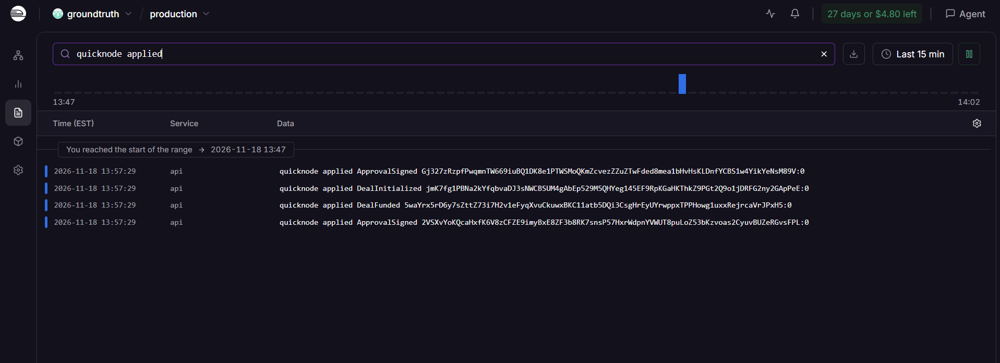

# GroundTruth Devpost draft

**Tagline:** Know the land before the money moves.

**One-sentence pitch:** GroundTruth helps a first-time Ohio land buyer understand a parcel before paying by showing sourced facts, honest gaps, and the person responsible for the next decision.

> Submission note: Keep every `[PENDING]` label until the named owner confirms the integration and supplies the required proof. Remove the label only after that proof is recorded in the repository.
>
> Checked Nov 18, 12:55 p.m. ET ([Readiness.md](Readiness.md)): both demo closings ran on devnet at 12:41 to 12:48 p.m. ET, and every escrow claim below was read back from the public RPC and opened on Solana Explorer. ElevenLabs and QuickNode Streams stay `[PENDING]`. No staged call is recorded. The two closings' timeline rows were backfilled with `replay:devnet`, not delivered by the Stream, so they are not Stream proof. The only QuickNode deliveries are the live stage deal's 4 `stage-prep` transactions, whose webhooks arrived 1–2 s after their blocks. The second-device check is still open.
>
> Updated Nov 18, 2:01 p.m. ET: QuickNode Streams delivered the stage deal's four transactions to the live timeline (below). The two closings above were backfilled with `replay:devnet` and are not Stream deliveries. At that time the API showed the held deal as `refunded` and the released deal still as `draft`; by 2:05 p.m. ET its replay had landed and the API showed it as `released`. ElevenLabs stays `[PENDING]`: no staged call is recorded.
>
> Updated Nov 18, 5:15 p.m. ET: **ElevenLabs is proven.** The staged owner callback was recorded at 5:10 p.m. ET and appears on the held deal's timeline as evidence (below). The call came after that deal's hold and refund, so it is evidence only. We enter the ElevenLabs bounty.
>
> Updated Nov 18, 10:50 p.m. ET ([Readiness.md](Readiness.md)): **closing in the product is proven.** On the live site, signed out, <https://groundtruth-lac.vercel.app/deals/staged-devnet-deal> reads `Refunded` with the hold, the `Release rejected · DealHeld (6019)` row, and the refund, and <https://groundtruth-lac.vercel.app/deals/staged-devnet-deal-released> reads `Released` with all three approvals. Every row's Explorer link matches the deal account's signatures on the public devnet RPC. That `[PENDING]` label is removed. QuickNode's second-device check is still `[PENDING]`.

## What it does

Buying vacant land can look simple until the buyer asks basic questions: Can I build here? Can I legally reach the lot? Is sewer service available? Is the person asking for my money authorized to sell it? The answers are scattered across parcel maps, county records, FEMA data, local rules, and professional reviews.

GroundTruth brings that evidence into one buyer-readable report. It shows what a public record supports, what it does not establish, who can resolve the open question, and what the buyer should do next. It is decision support, not a legal buildability opinion, title search, survey, identity service, or deed-transfer system.

The web demo searches live Ohio OGRIP parcels by address or parcel ID and opens each published boundary. The statewide layer covers all 88 counties, and we checked the deployed search in Franklin and Licking counties. The backend also builds live FEMA flood checks in the 83 counties with an NFHL study, and a water and sewer check for every lot: which community water system and which wastewater plant's sewershed EPA maps it inside, and, in Franklin County, the county sanitary engineer's service areas and the distance to the nearest public main where Dublin, Grove City, or Canal Winchester publishes its main map. When no public sewer is mapped, the report's bottom line says the septic soils matter and quotes their USDA rating. Missing or timed-out evidence stays `unknown` instead of becoming a guessed answer.

Our golden parcel is a real 3.015-acre vacant lot in Franklin County. County zoning maps it Rural, but county GIS shows no road right-of-way touching it and the nearest mapped road centerline is about 106 metres away. A title reviewer still has to determine whether a recorded access easement exists. That is the moment we want a first-time buyer to understand: acreage and zoning can look promising while legal access remains unresolved.

The second fixture is a real 1.2-acre vacant parcel in Licking County. Its boundary and FEMA finding are sourced, while the seeded zoning check remains `unknown` because GroundTruth has not integrated and reviewed that local zoning source yet. The report remains useful by naming the township zoning inspector as the next responsible person.

ALTA's 2026 survey of 245 title insurance professionals found that 59% of respondents reported at least one seller-impersonation attempt during 2025, compared with 28% of respondents in ALTA's 2024 survey reporting experience during 2023. Those are respondent-level reports of attempts, including failed attempts. They are not a per-sale probability or a count of successful frauds. This is why GroundTruth treats seller authority as a professional decision rather than a fact inferred from a parcel record.

**Solana escrow:** When the buyer proceeds, staged test USDC sits in a Solana devnet escrow until the staged reviewers sign. We ran both outcomes on devnet on the golden parcel, with staged wallets standing in for the buyer, the seller, and the title, survey, and septic reviewers.

- **A hold blocks the payout.** The buyer funded 25 test USDC. The staged title reviewer signed a hold. A [release was then attempted](https://explorer.solana.com/tx/Rro8WAjpc8w7s2taWhSeZaCUnxkLjN3Vx3iJCJdDboGTUVem8ZaX63FFvJhWaHFMHVLJ6EQwc4qG7H8r4MnvwGz?cluster=devnet) and the program rejected it with `DealHeld`: the vault still held 25 and the seller still held 0. The buyer then took a [refund](https://explorer.solana.com/tx/SgPJ9jQCNZfHrp1ipKK3tQ6LYwSaGS9qdhpkshUt8zNJW9JJ2s5V8B9WYuzq5nxLy3sWGvT94ZduEvSDgMzyaSo?cluster=devnet).
- **Cleared sign-offs release it.** On a second deal, the title, survey, and septic reviewers each signed an approval, and the [release](https://explorer.solana.com/tx/5kWpcHzaj1gic1gAehkJcQztexDn2jL2Y765WSXjEvRiFrDmDkYiy5EwY4gYSeeJHo9C6DGnAXrQ9EWDPZhvvHdC?cluster=devnet) paid exactly 25 test USDC to the bound seller and closed the vault.

**Closing in the product:** Both outcomes are on the live site. The [held deal page](https://groundtruth-lac.vercel.app/deals/staged-devnet-deal) shows the title hold, the rejected release with `DealHeld (6019)`, and the refund. The [released deal page](https://groundtruth-lac.vercel.app/deals/staged-devnet-deal-released) shows all three approvals and the payout. Each timeline row links to its transaction on Solana Explorer, and a QR code opens the same page on a phone with no app or wallet.

**ElevenLabs:** The owner callback supplies evidence to a staged title reviewer. The call never approves, holds, releases, or refunds a deal by itself. A real **ElevenLabs Agents** call to a consenting teammate playing the owner of record (conversation `conv_9801m7rbaxvye0yrq4jmyzfyq6xz`) ended at 22:10:40 UTC on Nov 18. The API verified its signed post-call webhook and logged `elevenlabs recorded ownerDeniesSale conv_9801m7rbaxvye0yrq4jmyzfyq6xz deal=staged-devnet-deal` at 22:10:54 UTC ([Railway log](../../proof/elevenlabs-owner-callback.png)). The held deal `staged-devnet-deal` shows it as an `Evidence received` row: the person reached as the owner on record said they are not selling.

  The call was recorded **after** that deal's hold and refund, so it appears after them on the timeline. In a real closing, this callback is what prompts the title reviewer to hold. Here it is shown as evidence only and changed no deal state. Only the title reviewer's signature, not the call, is what the escrow program checks.

**QuickNode Streams:** A Solana devnet Stream, filtered to our escrow program, sends confirmed program events to a signed webhook that writes them to the buyer's deal timeline. On Nov 18 the stage deal `staged-devnet-deal-live` ([`2UrftJ…F6Cg`](https://explorer.solana.com/address/2UrftJMzbvMngu6Mdg4PhFscqkCHnuLksfbSAiddF6Cg?cluster=devnet)) ran four transactions: initialize [`jmK7fg…pPeE`](https://explorer.solana.com/tx/jmK7fg1PBNa2kYfqbvaDJ3sNWCBSUM4gAbEp529M5QHYeg145EF9RpKGaHKThkZ9PGt2Q9o1jDRFG2ny2GApPeE?cluster=devnet), fund [`5waYrx…PxH5`](https://explorer.solana.com/tx/5waYrx5rD6y7sZttZ73i7H2v1eFyqXvuCkuwxBKC11atb5DQi3CsgHrEyUYrwppxTPPHowg1uxxRejrcaVrJPxH5?cluster=devnet), and the title [`2VSXvY…sFPL`](https://explorer.solana.com/tx/2VSXvYoKQcaHxfK6V8zCFZE9imyBxE8ZF3b8RK7snsP57HxrWdpnYVWUT8puLoZ53bKzvoas2CyuvBUZeRGvsFPL?cluster=devnet) and survey [`Gj327z…M89V`](https://explorer.solana.com/tx/Gj327zRzpfPwqmnTW669iuBQ1DK8e1PTWSMoQKmZcvezZZuZTwFded8mea1bHvHsKLDnfYCBS1w4YikYeNsM89V?cluster=devnet) approvals, in slots 523727603–523727618. All four were applied straight from the Stream, with no replay: the API logged `quicknode applied` for `DealInitialized`, `DealFunded`, and both `ApprovalSigned` events.

Railway's HTTP log shows each webhook arriving 1–2 s after its block (18:57:20–18:57:24 UTC). The 1.8–3.3 s first measured on the deal timeline came from polling the timeline API every 1.5 s against whole-second block times, so it includes up to 1.5 s of polling delay. The screenshot's app-log lines are all stamped 13:57:29 EST; the arrival times come from the HTTP log, which is not in the repo.

The two closings above are not Stream deliveries: their timeline rows were backfilled with `replay:devnet`, because QuickNode backfill needs a paid plan. **[PENDING]** The timeline update on a second device has not been measured separately. The team has confirmed the QuickNode bounty entry on the strength of the four Stream deliveries above.

## What makes it different

- **It names the gaps instead of hiding them.** Land tools usually show a listing or a score. GroundTruth shows each check's source and retrieval date, what that source does not establish, and the professional who can answer it. A missing or timed-out source stays `unknown`; it never becomes a guess.
- **Evidence, decisions, and money stay separate.** Public records supply evidence. A named reviewer signs the decision from their own wallet. The Solana program decides whether money moves: on devnet, a reviewer's hold made it reject a release while the vault kept all 25 test USDC.
- **A voice call is evidence, never authorization.** The ElevenLabs owner callback lands on the timeline for the title reviewer. It cannot approve, hold, or release anything.
- **The buyer never needs a wallet to follow along.** The deal page reads confirmed chain state and works on a phone from a QR code. Only the people who sign need a wallet.

## How we built it

We built GroundTruth as a pnpm workspace with one shared TypeScript contract. The React web app renders the search flow, parcel boundary, evidence cards, 3D land view, and staged closing interface. The Express API owns public-data access so the browser never talks directly to OGRIP, FEMA, PostgreSQL, or a provider that needs a secret.

For parcel discovery, the backend queries Ohio's statewide OGRIP parcel FeatureServer. Parcel IDs are normalized without changing the published local ID, and address search uses Ohio's LBRS locator with a bounded site-address fallback. The API returns the published geometry, source URL, and retrieval time.

For reports, each evidence check runs independently. The live pipeline combines the OGRIP parcel with FEMA's National Flood Hazard Layer, the National Wetlands Inventory, USDA soils, and EPA's community water system and sewershed maps everywhere, plus Franklin County's zoning, road, stream-buffer, and sanitary engineering service-area layers in Franklin, and the water and sewer main maps of the three Franklin County cities that publish them. A provider miss, timeout, or uncovered county becomes an explicit `unknown` check with a responsible party and next action. The manually verified Franklin fixture adds county zoning, the zoning resolution, the Auditor's legal acreage, county right-of-way and road layers, and the Big Darby riparian-setback layer. The Licking fixture deliberately demonstrates a partial report.

Prisma maps the shared contract into PostgreSQL for seeded and cached reports. The API exposes health, parcel search, parcel detail, report, coverage, staged deal, and timeline routes. Tests replay recorded public-provider responses so the normal, missing-data, and timeout paths remain reproducible without inventing facts.

The web is built with React, Vite, TypeScript, Three.js, and react-globe.gl. The API uses Node.js, Express, Zod, Prisma, and PostgreSQL. Vercel hosts the web deployment and Railway hosts the API and database documented in the repository.

**Escrow program on devnet:** The Rust and Anchor escrow program is deployed to Solana devnet as [`ASQoBtBsz1igQXsWzKZqFYqBGtBX4ErCJjNpuo8rEBZG`](https://explorer.solana.com/address/ASQoBtBsz1igQXsWzKZqFYqBGtBX4ErCJjNpuo8rEBZG?cluster=devnet) ([deploy transaction](https://explorer.solana.com/tx/4jSbDspA2EBfhghHxmiZJ5mkce4Ho4CZ34aqawPdMVJzDGjJxXdRfxjjMREgiKdnfpxeDXVgUqpECTwb8T39P8NU?cluster=devnet)). Its published Anchor IDL ([metadata account](https://explorer.solana.com/address/uQZLX7rQRUceEZdPYyxFtE8ei386h3XKatFkRJ3wZma?cluster=devnet)) is identical to the IDL our backend decodes events with.

**Escrow outcomes on devnet (Nov 18, 2026):** Both deals use the golden parcel, 25 test USDC (Circle's devnet mint `4zMMC9srt5Ri5X14GAgXhaHii3GnPAEERYPJgZJDncDU`), and the same staged wallets. Every transaction below is finalized.

Held deal, [`54Va6q…E4tW`](https://explorer.solana.com/address/54Va6qKNQTsbuXTqi4tXaPVgdkQh4S7McsCKsjKPE4tW?cluster=devnet):

| Step | Transaction | Buyer | Vault | Seller |
| --- | --- | --- | --- | --- |
| Initialize | [`4ZscUV…KjNv`](https://explorer.solana.com/tx/4ZscUVnfZ3W5ukt7H8tSBrQZNrvY5Hu3Qq9oRNJeTbHj61UvwcPAAssZJ4DtaxzeVQAb2rcFPYyRGWsQuaoPKjNv?cluster=devnet) | 40 | 0 | 0 |
| Fund | [`grkKU9…dd74`](https://explorer.solana.com/tx/grkKU9YqV1xpAkHySCjdhLgavpd5dW3mJsvbiZ1tjEyvuHC9T373Hmscubsm8UapaA7j93pHrseJMepw1C3dd74?cluster=devnet) | 15 | 25 | 0 |
| Title reviewer places hold | [`5QovFT…J2ib`](https://explorer.solana.com/tx/5QovFTbAMquUY5M5NpJwZPUJhtcKAcmQ5xmZhvFWT46KfPh3UBkaQMhgQhcuphBqvTiYLUgTmNNS7b8tyR7JJ2ib?cluster=devnet) | 15 | 25 | 0 |
| Release attempted: **rejected**, `DealHeld` (6019) | [`Rro8WA…vwGz`](https://explorer.solana.com/tx/Rro8WAjpc8w7s2taWhSeZaCUnxkLjN3Vx3iJCJdDboGTUVem8ZaX63FFvJhWaHFMHVLJ6EQwc4qG7H8r4MnvwGz?cluster=devnet) | 15 | 25 | 0 |
| Buyer refund | [`SgPJ9j…yaSo`](https://explorer.solana.com/tx/SgPJ9jQCNZfHrp1ipKK3tQ6LYwSaGS9qdhpkshUt8zNJW9JJ2s5V8B9WYuzq5nxLy3sWGvT94ZduEvSDgMzyaSo?cluster=devnet) | 40 | closed | 0 |

Released deal, [`3uBECm…2yu`](https://explorer.solana.com/address/3uBECmkG9XKbJbGisPjqWNxy6Sb3knVZ2cnwF7jby2yu?cluster=devnet):

| Step | Transaction | Buyer | Vault | Seller |
| --- | --- | --- | --- | --- |
| Initialize | [`ZFo3g3…hM9M`](https://explorer.solana.com/tx/ZFo3g36XTKCaVkLJKpgD2S2sGf4zqNVp3tsFkpSPeJ9mNyfJbWCHtjPDbAV8oUvdXGZs7Ag7n9jTxGbRhh2hM9M?cluster=devnet) | 40 | 0 | 0 |
| Fund | [`4a2HxS…txgR`](https://explorer.solana.com/tx/4a2HxSta9rKio7BsFMVzTvKfA9yBBSzr9uFzJEtDDNG3wJi7hzsJCgkM8SuCt3qQfkUCg4VUM8VCwxHykhDwtxgR?cluster=devnet) | 15 | 25 | 0 |
| Three reviewer approvals | [`5Rnsas…jBqt`](https://explorer.solana.com/tx/5Rnsas4nLpLJM8ss63dB2768wbTRJteEWBMCE7Z4njzE1JNk547WQ7nQdp38W8Go25tX2YsQtvvn5nRNdEV5jBqt?cluster=devnet) · [`3D8ahB…jL9P`](https://explorer.solana.com/tx/3D8ahBLYuhCiZfNZcMgQZZ3UQnHeoNcBFCgu9NLbyao1TZUMCKBn4RjWcKYJhQupNiZy1JiXnyN8UUARFM57jL9P?cluster=devnet) · [`7tnvjT…S2fb`](https://explorer.solana.com/tx/7tnvjTxYw6vu7xFKCDTJ4fJGjerS6SCJ3QfSkFn3N916bXaBVEmBnrYwrF9hHSFyCurox1Kct9YdcJGxm4XS2fb?cluster=devnet) | 15 | 25 | 0 |
| Release to the bound seller | [`5kWpcH…vHdC`](https://explorer.solana.com/tx/5kWpcHzaj1gic1gAehkJcQztexDn2jL2Y765WSXjEvRiFrDmDkYiy5EwY4gYSeeJHo9C6DGnAXrQ9EWDPZhvvHdC?cluster=devnet) | 15 | closed | 25 |

Balances are test USDC after each step, read from the transactions' token balances on the public devnet RPC. Where a step does not touch an account, its value is carried from the steps on either side. The rejected release's log reads: "Error Code: DealHeld. Error Number: 6019. Error Message: Cannot release funds while deal is under active hold."

Not shown on devnet: a second release attempt on the released deal. The vault is closed, and the local test suite covers repeated settlement.

**Sponsor integrations:**
- **QuickNode Streams** delivered the stage deal's four transactions to the live timeline (see above). The two closings' timeline rows came from `replay:devnet`, not the Stream.
- **ElevenLabs:** a real staged owner callback was recorded, verified, and attached to the held deal's timeline as evidence. It was recorded after the hold and refund, so it is evidence only. We enter the ElevenLabs bounty.

## Challenges we ran into

The hardest product challenge was resisting a confident answer when the records did not support one. A parcel boundary can show that a lot is near a road, but it cannot prove a legal right of access. A tax land-use class is not zoning. Zone X means minimal mapped flood hazard, not zero flood risk. We had to make those limitations useful instead of hiding them in fine print.

Ohio's statewide parcel layer gives us broad discovery, but local evidence is fragmented. Counties use different parcel-ID formats, addresses are inconsistent, vacant lots may have no house number, and local zoning or utility data may live in a separate system. Columbus, for one, publishes no map of its water or sewer mains, so a Columbus lot gets its EPA water and sewer service areas but no distance to a main, and the report says so. We built normalization and failure states around those differences instead of pretending every county has the same depth.

External services also fail in ordinary ways. OGRIP or FEMA can time out, return no match, or omit a county study. We designed the report so one failed check does not erase the evidence that did return, and so a timeout never turns into a positive or negative land-use conclusion.

Finally, we had to keep three kinds of truth separate: a public record supplies evidence, a qualified reviewer makes a decision, and a payment system enforces where money moves. Blurring those roles would make the demo simpler, but the product less trustworthy.

## Accomplishments that we're proud of

- We search real OGRIP parcel data through the backend for all 88 Ohio counties and preserve the published parcel IDs and boundaries.
- We tested the full search, boundary, and report path in Franklin and Licking counties rather than presenting an invented sample.
- We built live FEMA flood checks for the 83 Ohio counties with an NFHL study and return an honest `unknown` state for the five without one.
- We check public water and sewer for every Ohio lot. Run live on the rural golden parcel, the check finds no mapped public water or sewer and says a private well and a septic system are likely; on a Grove City lot it finds city water and sewer mains along the lot line. A map never stands in for an availability letter: every answer names who to ask for one.
- We created a deeply sourced Franklin County golden report with zoning and flood evidence, a legal-access review flag, dated sources, and a named next actor.
- We created a second-county report that stays useful when a local check is not integrated instead of filling the gap with a fallback value.
- We handle provider timeouts without guessing, and recorded tests cover parcel-ID variations, addresses, missing parcels, flood-zone combinations, and missing FEMA studies.
- We built a responsive buyer experience with real parcel geometry, baked aerial imagery and elevation for the staged parcels, and clear evidence and limitation states.

- We ran both closings on Solana devnet: a reviewer's hold made the program reject a release with the vault balance unchanged, and three reviewer approvals released exactly 25 test USDC to the bound seller. Each step has an Explorer link above.

- QuickNode Streams delivered four confirmed escrow transactions from devnet to our webhook 1–2 s after their blocks, with no replay ([Railway log](../../proof/quicknode-stage-prep.png)).

- An ElevenLabs Agents call to a consenting teammate playing the owner of record reached our signed webhook. The webhook recorded the answer (`ownerDeniesSale`) as evidence on the held deal's timeline ([Railway log](../../proof/elevenlabs-owner-callback.png)). The call never approves, holds, or releases anything. In this staged run it was recorded after the hold and refund.

## What we learned

We learned that `unknown` can be a useful product result. A buyer does not need false certainty. They need to know what is missing, why it matters, and who can resolve it.

We also learned that broad coverage and deep coverage are different measurements. OGRIP gives us statewide parcel discovery, while zoning, access, utilities, and septic evidence depend on the local authority. GroundTruth should show both measurements instead of turning one verified county into a statewide claim.

The most important design lesson was to keep evidence, professional judgment, and payment enforcement separate. Public records can narrow the question. A title reviewer, surveyor, zoning official, or health authority resolves it. A payment system can then enforce the signed conditions, but it cannot decide whether the land is buildable or whether a seller is legitimate.

## What's next for GroundTruth

This section and the site's roadmap page (`/roadmap`) say the same thing; change them together ([`frontend/web/src/content/roadmap.ts`](../../../frontend/web/src/content/roadmap.ts)). Only **Now** is built. Every **Next** and **Later** item is a plan, and no pilot or partner exists yet.

### Now (live today, on Solana devnet with test USDC and staged reviewer wallets)

- **Ohio parcel search and the 3D land view.** Search any Ohio parcel by address or parcel ID, using the state's OGRIP boundaries for all 88 counties. Open a lot to see its boundary in gold on real aerial imagery and terrain, and turn it in 3D.
- **Sourced reports, check by check.** Flood, wetlands, septic soils and public water and sewer service are read from FEMA, the National Wetlands Inventory, the USDA soil survey and EPA wherever those maps cover the lot. Zoning, road access and stream setbacks are read in Franklin County so far, and any check without a record says No answer yet instead of guessing.
- **Solana escrow: holds block payouts, approvals release.** A reviewer's hold makes the payout fail on-chain, and the test USDC stays in the vault. Once every required reviewer approves, the program releases the exact USDC amount the deal was opened with.
- **Reviewer portal, documents, and Verify on-chain.** Title, survey and septic reviewers approve or hold from their wallet, on a phone too through the Phantom app's browser. Each document's hash is written on-chain, and Verify on-chain reads the escrow account straight from Solana devnet to check the page against it.
- **Live updates and an owner callback.** QuickNode Streams sends each confirmed escrow transaction to the backend, and the deal's timeline updates without a reload. An ElevenLabs voice agent's call to the owner on record is saved on the held deal's timeline as evidence, never as an approval.
- **Ask this lot.** Ask a question in plain English or by microphone and get an answer drawn only from that parcel report's checks and sources. Every answer cites its check and record, and an uncovered question says I don't know and names the responsible party.

Still open in the live build:

- **[PENDING] QuickNode Streams:** measure the timeline update on a second device, and deliver the stage deal's septic approval and release through the Stream.
- **ElevenLabs:** place the owner callback before the title reviewer decides, as it would sit in a real closing. In the staged run it was recorded after the hold.

### Next (pilot) · planned, not built yet

- **A title or closing company pilot in Ohio.** Run real deals with an Ohio title or closing company, with its licensed staff as the reviewers and private, signed-in evidence handling in place first. The professionals, not us, would define when money is released and when it is refunded.
- **Mainnet with real USDC and sponsored fees.** Move the escrow from devnet test funds to Solana mainnet and real USDC. Network fees would be sponsored, so a reviewer never needs to hold SOL to sign.
- **Pay with Solana Pay.** The buyer funds the escrow by scanning a QR code with their wallet. The amount and the escrow address would come filled in, so nothing has to be typed or copied.
- **Verified reviewer credentials.** Licensed title, survey and septic professionals would carry a credential that can be checked on-chain. The escrow would count an approval only from a wallet that holds the right one.
- **More local checks.** Zoning for more Ohio counties, and the distance to water and sewer mains in more cities than the few that publish their main maps. Easements would be read from recorded documents, each one cited like every other check.

### How we'll measure the pilot

These are the measures from [Problem.md](../../context/Problem.md#proof-pilot-and-beyond). There is no pilot yet, so there are no results to show.

1. **Time to the first actionable finding:** how long from opening a lot until the buyer has one concrete thing to do next.
2. **Findings with traceable evidence:** the share of material findings that link to the public record or sign-off behind them.
3. **Buyers who can explain a pause:** when a deal is paused, whether the buyer can say why and what has to happen next.

### Later (scale) · planned, not built yet

- **Nationwide parcels.** Parcel boundaries beyond Ohio would come from a nationwide provider such as Regrid. FEMA's flood maps are already a national service, so the flood check would carry over wherever FEMA has mapped.
- **Deed recording handoff.** After the escrow releases, the deed would be handed to the county's e-recording system. The recording receipt would join the deal's timeline beside the payout.
- **Seller identity verification.** A trusted identity partner would confirm the seller is the owner on record. It would be a step inside the closing flow, finished before any reviewer can approve.
- **Milestone payments and deadlines.** A deal could be split into staged payments, each with its own deadline. If a review never arrives in time, the buyer's money would be refunded automatically.
- **Saved lots with alerts.** Save a lot and get an alert when its public records change, such as a new flood map. Each alert would link to the source that changed.

## Technologies used

### Working on `main`

- Rust and Anchor: the escrow program is deployed to Solana devnet (see the program link above)
- Solana devnet escrow deals: SPL Token transfers of Circle test USDC (two deals run, links above)
- TypeScript and pnpm workspaces
- React, Vite, Three.js, and react-globe.gl
- Node.js, Express, and Zod
- Prisma and PostgreSQL
- Ohio OGRIP statewide parcels and LBRS address locator through ArcGIS REST services
- FEMA National Flood Hazard Layer
- US EPA Community Water System Service Area Boundaries and publicly owned treatment works sewersheds (Clean Watersheds Needs Survey 2022)
- Franklin County Sanitary Engineering service areas, and the public water and sewer main maps of Dublin, Grove City, and Canal Winchester
- Franklin County Auditor, zoning, road right-of-way, road-section, and stream-buffer sources for the verified golden parcel
- Vitest and Supertest
- Vercel and Railway deployment configuration
- QuickNode Streams: live delivery of the stage deal's four transactions to the deal timeline (second-device update not yet measured)
- ElevenLabs Agents: a staged owner callback, recorded as evidence on the held deal's timeline (conversation `conv_9801m7rbaxvye0yrq4jmyzfyq6xz`)
